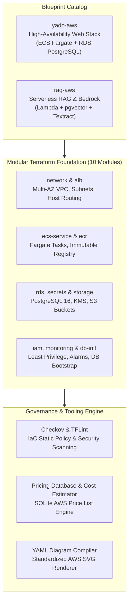

<div align="center">

# aws-blueprint

**Production-grade AWS architecture blueprints, reusable Terraform modules, and cost estimation models.**

[](https://www.terraform.io/)
[](https://aws.amazon.com/)
[](https://aws.amazon.com/fargate/)
[](https://aws.amazon.com/bedrock/)
[](https://aws.amazon.com/rds/)
[](https://www.checkov.io/)

[Architecture](#architecture) • [Features](#features) • [Blueprints](#blueprint-catalog) • [Modules](#modular-terraform-foundation) • [Tools](#engineering-tooling) • [Quick Start](#quick-start) • [Operations](#operations--tooling-runbook) • [Structure](#repository-structure) • [Docs](#documentation-index)

</div>

---

> **A modular repository of production-grade AWS infrastructure blueprints, reusable Terraform modules, and cost estimation models.** Designed to translate real-world on-premises and homelab workloads into resilient cloud architectures with zero guesswork, static security validation, and auditable financial estimates.

---

## Architecture



---

## Features

<table>
  <tr>
    <td width="50%" valign="top">
      <h4>Production IaC & Architecture</h4>
      <ul>
        <li><strong>yado-aws HA Stack</strong>: Enterprise-grade web architecture on ECS Fargate, private RDS PostgreSQL 16, Route 53, ACM, and ALB host-based routing.</li>
        <li><strong>rag-aws Serverless Pipeline</strong>: Event-driven document processing with S3 ingest, Lambda workers, Bedrock foundation models, and pgvector.</li>
        <li><strong>10 Reusable Modules</strong>: Extensible Terraform modules enforcing least-privilege IAM, multi-AZ network isolation, and KMS encryption.</li>
        <li><strong>Homelab-to-Cloud Migration</strong>: Production runbooks translating self-hosted LXC services into managed cloud equivalents with zero trust.</li>
      </ul>
    </td>
    <td width="50%" valign="top">
      <h4>Engineering Tooling & Governance</h4>
      <ul>
        <li><strong>Checkov Security Scanning</strong>: Automated policy-as-code audits for CIS benchmarks, encryption at rest, and network segmentation.</li>
        <li><strong>Deterministic Cost Modeling</strong>: Python CLI backed by local SQLite AWS Price List database for reproducible OpEx projections.</li>
        <li><strong>YAML Diagram Engine</strong>: Headless CLI compiler translating declarative specs into official AWS architecture SVGs.</li>
        <li><strong>Standardized Scaffolding</strong>: Consistent <code>_template</code> blueprint layout with built-in documentation architecture.</li>
      </ul>
    </td>
  </tr>
</table>

---

## Blueprint Catalog

| Blueprint | Primary Services | Status | Architecture Highlights |
|---|---|---|---|
| [yado-aws](blueprints/yado-aws/) | ECS Fargate, ALB, RDS PostgreSQL 16, Secrets Manager, S3, ECR | `prototype` | Multi-AZ VPC, zero-trust task execution, immutable ECR tags, rolling zero-downtime deployments, automated DB initialization |
| [rag-aws](blueprints/rag-aws/) | Bedrock, Lambda, API Gateway, S3, SQS, RDS pgvector, Textract | `drafted` | Asynchronous document ingestion, serverless vector search, citation attribution, zero-NAT private VPC endpoints |

---

## Modular Terraform Foundation

All Terraform modules live under [`blueprints/yado-aws/modules/`](blueprints/yado-aws/modules/) and follow strict isolation and least-privilege standards:

| Module | Scope & Managed Resources | Security & Key Features |
|---|---|---|
| [`alb`](blueprints/yado-aws/modules/alb/) | Application Load Balancer, Route 53, ACM | Host-based routing, TLS 1.3 enforcement, invalid header dropping |
| [`db-init`](blueprints/yado-aws/modules/db-init/) | One-off bootstrap ECS Fargate task | Automated schema provisioning & least-privilege per-service roles |
| [`ecr`](blueprints/yado-aws/modules/ecr/) | Elastic Container Registry repositories | Immutable image tags, automated scan-on-push, retention policies |
| [`ecs-service`](blueprints/yado-aws/modules/ecs-service/) | Fargate task definitions & service wiring | Circuit-breaker rolling updates, isolated security groups, health checks |
| [`iam`](blueprints/yado-aws/modules/iam/) | Execution roles & per-app task roles | Fine-grained least privilege, S3 prefix scoping, no wildcard admin |
| [`monitoring`](blueprints/yado-aws/modules/monitoring/) | CloudWatch alarms, dashboard & SNS | Task crash detection, 5xx rate alerts, p95 latency thresholds |
| [`network`](blueprints/yado-aws/modules/network/) | Multi-AZ VPC, public/private subnets | Strict subnet tier isolation, VPC Flow Logs, no inbound public DB |
| [`rds`](blueprints/yado-aws/modules/rds/) | PostgreSQL 16 instance & subnet groups | KMS storage encryption, automated backups, Secrets Manager credentials |
| [`secrets`](blueprints/yado-aws/modules/secrets/) | AWS Secrets Manager secret containers | Dynamic high-entropy password generation, zero plain-text leaks |
| [`storage`](blueprints/yado-aws/modules/storage/) | Application S3 buckets & lifecycle rules | SSE-KMS encryption, versioning, explicit public access block |

---

## Engineering Tooling

| Tool | Path | Capabilities & Implementation |
|---|---|---|
| **Architecture Diagram Renderer** | [`tools/diagram/`](tools/diagram/) | Headless Python CLI (`render.py`) compiling declarative YAML specs into crisp AWS SVG diagrams using official icons. |
| **AWS Price List Engine** | [`tools/pricing/`](tools/pricing/) | SQLite price database syncing official AWS bulk pricing for region-specific rate queries without external API dependencies. |
| **Blueprint Cost Estimator** | [`blueprints/rag-aws/cost/`](blueprints/rag-aws/cost/) | Automated Python financial modeling script (`estimate.py`) calculating itemized monthly run rates from local pricing databases. |

---

## Tech Stack

| Layer | Technology | Role |
|---|---|---|
| **Infrastructure as Code** | Terraform 1.5+ | Declarative multi-module infrastructure orchestration |
| **Compute & Containers** | AWS ECS Fargate & AWS Lambda | Serverless container orchestration and event-driven microservices |
| **Database & Search** | Amazon RDS PostgreSQL 16 & pgvector | Relational persistence, automated backups, and vector embeddings |
| **Generative AI** | Amazon Bedrock & AWS Textract | Managed foundation models and document OCR extraction |
| **Security & Governance** | Checkov & AWS KMS / IAM | Policy-as-code validation, customer-managed encryption, and role isolation |
| **Developer Tooling** | Python 3.11+ & SQLite | Spec diagram generation and automated AWS pricing calculations |

---

## Quick Start

### Prerequisites
- **Terraform 1.5+** & **TFLint** installed locally.
- **Python 3.11+** (for diagram rendering and pricing analysis).
- **Checkov** for policy-as-code static security analysis.

### Local Rehearsal & Verification in 4 Steps

```bash
# 1. Clone repository and inspect blueprint modules
git clone https://github.com/username/aws-blueprint.git
cd aws-blueprint

# 2. Validate Terraform module syntax and formatting
terraform -chdir=blueprints/yado-aws/envs/prototype init -backend=false
terraform -chdir=blueprints/yado-aws/envs/prototype validate

# 3. Rehearse execution plan against local emulator
terraform -chdir=blueprints/yado-aws/envs/prototype plan -var use_emulator=true

# 4. Execute automated security compliance scanning
checkov -d blueprints/yado-aws/modules/
```

---

## Operations & Tooling Runbook

Operational procedures for updating pricing data, rendering diagrams, and auditing code:

```bash
# Sync official AWS pricing for a target region into local SQLite database
python tools/pricing/pricing.py update --region ap-southeast-1 --raw-dir ~/aws-pricing/raw

# Query local price database for specific resource hourly rates
python tools/pricing/pricing.py find "nat gateway" --offer AmazonEC2

# Render blueprint architecture diagram from YAML spec
python tools/diagram/render.py render blueprints/rag-aws/diagrams/architecture.yml

# Run cost estimation model for serverless RAG pipeline
python blueprints/rag-aws/cost/estimate.py --json
```

---

## Authoring Workflow

Creating and standardizing a new AWS blueprint follows a deterministic 4-step sequence:

```bash
# 1. Scaffold blueprint from repository baseline template
cp -r _template blueprints/<slug>

# 2. Configure architecture spec and documentation
# Edit blueprints/<slug>/README.md and diagrams/architecture.yml

# 3. Render official SVG architecture diagrams
python tools/diagram/render.py render blueprints/<slug>/diagrams/architecture.yml

# 4. Verify IaC security compliance and validate syntax
terraform -chdir=blueprints/<slug>/modules fmt -check
checkov -d blueprints/<slug>/modules/
```

---

## Troubleshooting

| Symptom | Probable Cause | Immediate Remediation |
|---|---|---|
| `Checkov CKV_AWS_* policy failure` | Missing mandatory security attribute | Check module resource configurations (e.g., KMS encryption, access logging, public block). |
| `Missing pricing DB (prices.db)` | AWS price list not yet downloaded | Run `python tools/pricing/pricing.py update --region ap-southeast-1 --raw-dir ~/aws-pricing/raw`. |
| `Diagram render icon not found` | Official icon pack path unconfigured | Set `AWS_ICON_PACK` environment variable or define `pack` path in `tools/diagram/config.toml`. |
| `Terraform provider init error` | Missing network access or plugin cache | Run `terraform init -backend=false` or configure local plugin mirror in `.terraformrc`. |
| `SQLite database locked during sync` | Concurrent process accessing DB | Ensure background price updater or estimation script completes before re-running update. |

---

## Limitations & Design Principles

- **Planning Blueprints**: Blueprints serve as production-grade implementation references and cost models. They are statically verified and rehearsed against emulators, not applied to live AWS accounts.
- **Cost Transparency**: Cost models derive strictly from the official AWS Price List API. Real bills may vary based on data transfer tiers, sustained use discounts, or AWS Free Tier allowances.
- **Least-Privilege Boundaries**: All modules avoid wildcard IAM permissions and isolate container execution into private subnets with strict security group egress controls.

---

## Repository Structure

```
aws-blueprint/
├── blueprints/
│   ├── yado-aws/             # HA containerized web stack on ECS Fargate & RDS
│   │   ├── envs/prototype/   # Prototype environment configuration & variables
│   │   ├── modules/          # 10 reusable production-grade Terraform modules
│   │   ├── docs/             # Architecture, cost model, migration, failure drills
│   │   └── diagrams/         # Visual architecture definitions & assets
│   └── rag-aws/              # Serverless RAG knowledge base on Bedrock & Lambda
│       ├── cost/             # Automated Python monthly OpEx estimation script
│       ├── diagrams/         # Declarative YAML diagram specification
│       └── docs/             # Architectural decisions, cost analysis, data flow
├── tools/
│   ├── diagram/              # Headless YAML-to-SVG AWS architecture diagram compiler
│   └── pricing/              # SQLite caching engine for official AWS Price List API
├── _template/                # Scaffold template for authoring new AWS blueprints
└── README.md                 # Repository architecture index & governance
```

---

## Documentation Index

Detailed architectural decisions, operational runbooks, failure drills, and cost breakdowns are decomposed across blueprint documentation directories:

| Blueprint / Scope | Document | Focus & Highlights |
|---|---|---|
| **yado-aws** | [Architecture](blueprints/yado-aws/docs/architecture.md) | High-availability topology, ingress traffic, and service boundaries |
| **yado-aws** | [Cost Model](blueprints/yado-aws/docs/cost.md) | Itemized monthly expense estimates across Fargate, RDS, and ALB |
| **yado-aws** | [Failure Drill](blueprints/yado-aws/docs/failure-drill.md) | Simulated task crash recovery, health checks, and alerting behavior |
| **yado-aws** | [Migration Plan](blueprints/yado-aws/docs/migration.md) | Step-by-step Proxmox homelab to AWS migration runbook |
| **yado-aws** | [Security Audit](blueprints/yado-aws/docs/security-scan.md) | Checkov static analysis results, findings triage, and mitigations |
| **rag-aws** | [Architecture](blueprints/rag-aws/docs/architecture.md) | Serverless event-driven document processing and Bedrock integration |
| **rag-aws** | [Decisions](blueprints/rag-aws/docs/decisions.md) | Architectural decision records (ADRs) for embeddings and VPC endpoints |
| **rag-aws** | [Cost Model](blueprints/rag-aws/docs/cost.md) | Detailed financial projections based on SQLite AWS Price List data |
| **Tools** | [Diagram Engine](tools/diagram/README.md) | Declarative YAML specification syntax, icon resolution, and rendering options |
| **Tools** | [Pricing Database](tools/pricing/README.md) | Official AWS Price List ingestion, schema, and search queries |
| **Blueprint Template** | [Template Docs](_template/docs/architecture.md) | Standardized documentation scaffolding for new architecture proposals |

---

## License

Distributed under the [MIT License](LICENSE).
