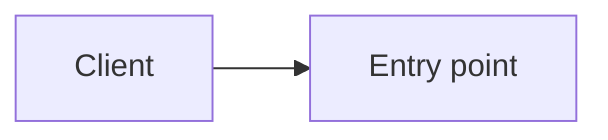

# Architecture

## Diagram

## Components
| Component | AWS service | Purpose |
|-----------|-------------|---------|
|           |             |         |

## Networking
VPC, subnets, security groups.

## Security
IAM roles, encryption, secrets.

## Observability
Logs, metrics, alarms.
