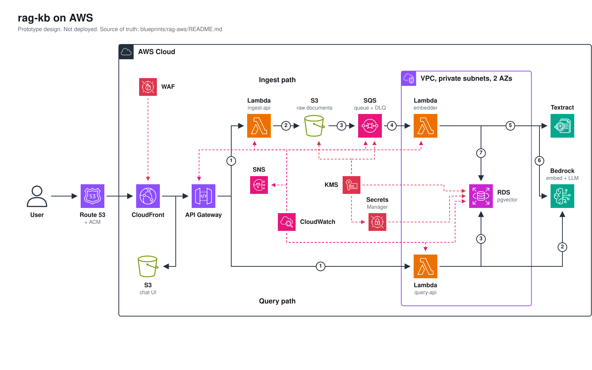

# Architecture

Design only. Nothing here is deployed, and there is no Terraform yet. Decisions behind the choices are in [decisions.md](decisions.md); region, embedding model and generation model are still proposals there (D8 to D10).

## Diagram

Source: [../diagrams/architecture.yml](../diagrams/architecture.yml). Solid arrows are the two data paths, numbered by step. Dashed red and pink links are security and operations services.

## Components

| Component | AWS service | Purpose | Network |
|---|---|---|---|
| DNS and certificate | Route 53, ACM | Domain for the chat page and the API | Global (the CloudFront certificate must live in us-east-1) |
| Edge | CloudFront, WAF | One front door for the UI and the API, with managed rules and a rate limit | Global (the web ACL must live in us-east-1) |
| Chat page | S3 (private bucket) | Static UI, read by CloudFront through origin access control | Regional |
| API | API Gateway | `POST /ingest` and `POST /query`, throttling per route | Regional |
| `ingest-api` | Lambda | Validates type and size, returns a presigned upload URL | Outside the VPC |
| Raw documents | S3 | Uploaded files, the source of truth for re-ingest | Regional |
| Ingest buffer | SQS with a dead-letter queue | Holds `ObjectCreated` events, retries, caps concurrency | Regional |
| Embedder | Lambda | Fetches the object, extracts text, chunks, embeds, writes to RDS | Private subnets |
| OCR | Textract | Text from scans and images | Regional, reached through an endpoint |
| Model access | Bedrock | Embeddings for chunks and questions, answer generation | Regional, reached through an endpoint |
| Vector store | RDS PostgreSQL with pgvector | Sources, chunks, vectors, metadata | Private subnets |
| `query-api` | Lambda | Embeds the question, retrieves top-k chunks, calls the LLM, returns answer and citations | Private subnets |
| Keys and secrets | KMS, Secrets Manager | Encryption keys and the database credential | Regional |
| Operations | CloudWatch, SNS | Logs, metrics, alarms, alarm email | Regional |

## Data model

The schema is the one `rag-kb` already uses (`migrations/001_init.sql` and `002_kinds.sql` in that repo), so the code that reads and writes it carries over.

| Table | Columns that matter |
|---|---|
| `sources` | `repo`, `relpath`, `kind` (md, pdf, pptx, docx, image and others), `sha256`, `bytes`, `status` (ok, empty, ocr-low, ocr-failed and others), `indexed_at`. Unique on `(repo, relpath)` |
| `chunks` | `source_id` (cascade delete), `ord`, `title`, `locator`, `text`, `text_sha`, `model`, `embedding vector(1024)` |

- An HNSW index with cosine distance sits on `chunks.embedding`, and `chunks.source_id` is indexed.
- On AWS the S3 object key plays the role of `relpath`, and the bucket prefix plays the role of `repo`.
- `sha256` makes ingest idempotent: uploading the same file again is a no-op, and a changed file replaces its chunks.
- `chunks.model` records which embedding model produced each vector. Vectors from different models are not comparable, so a model change means re-embedding every row (D9).
- Two database roles: the embedder writes, `query-api` only reads.

## Flows and failure behavior

Ingest, steps as numbered on the diagram:

| Step | Failure behavior |
|---|---|
| 1 to 3: URL, upload, event | A failed upload leaves no object and no event. Presigned URLs expire |
| 4: SQS to embedder | The visibility timeout is longer than the Lambda timeout. After a few failed receives the message moves to the dead-letter queue and an alarm fires |
| 5: Textract | Throttling is retried with backoff. The queue's concurrency cap keeps requests under Textract's low default quota (D5) |
| 6: Bedrock embeddings | Throttling is retried with backoff, then the message goes back to the queue |
| 7: write to RDS | One transaction per source: delete old chunks, insert new ones, update `sources`. A retry after a crash repeats the same transaction |

Query: the three steps run inside one request. Bedrock is called twice (embed the question, then generate), so a Bedrock failure returns an error to the caller instead of a partial answer. The response carries the generated text plus, for each chunk used, the source path and locator.

## Networking

- One VPC with private subnets in two AZs. No public subnets, no internet gateway, no NAT (D2).
- `ingest-api` is outside the VPC (D3). CloudFront, API Gateway, S3, SQS and Bedrock are public regional endpoints that need no VPC placement.
- SQS needs no endpoint, because the Lambda event source mapping polls the queue from outside the VPC.

Endpoints, represented by the single icon on the VPC border:

| Endpoint | Type | Used by |
|---|---|---|
| S3 | Gateway | Embedder, to read raw documents |
| Bedrock runtime | Interface | Embedder, `query-api` |
| Textract | Interface | Embedder |
| Secrets Manager | Interface | Embedder, `query-api` |
| CloudWatch Logs | Interface | Embedder, `query-api` |
| KMS | Interface | Only if code calls KMS directly, which is not expected |

Security groups, one per role:

| Group | Inbound | Outbound |
|---|---|---|
| Lambda | none | 5432 to the RDS group, 443 to the endpoint group, and the S3 gateway prefix list |
| RDS | 5432 from the Lambda group only | none |
| Endpoints | 443 from the Lambda group only | none |

## Security

IAM, one role per function, least privilege:

| Role | Allowed |
|---|---|
| `ingest-api` | `s3:PutObject` on the raw bucket, log writes |
| Embedder | `s3:GetObject` on the raw bucket, Textract text detection, `bedrock:InvokeModel` on the embedding model, `secretsmanager:GetSecretValue` on the database secret, SQS receive and delete for its queue, log writes |
| `query-api` | `bedrock:InvokeModel` on the embedding model and the generation inference profile, `secretsmanager:GetSecretValue` on the database secret, log writes |

Encryption and exposure:

- At rest: S3 raw bucket, SQS, RDS storage and Secrets Manager use a customer managed KMS key.
- In transit: TLS everywhere, with a bucket policy that denies requests without it.
- Both S3 buckets block public access. The chat page bucket is readable only by CloudFront.
- The database credential lives in Secrets Manager. Rotation is optional for the prototype.
- WAF holds managed rule sets and a rate-based rule on the CloudFront distribution.
- There is no authentication yet, so the API is open behind the rate limit. This is the largest gap (see decisions.md, "Not decided yet").

## Observability

- Logs: every Lambda and API Gateway access logs to CloudWatch Logs, with an explicit retention period.
- Alarms, all sent to one SNS topic with an email subscription:

| Alarm | Signal |
|---|---|
| Dead-letter queue not empty | Visible messages on the dead-letter queue |
| Lambda errors and throttles | Per function |
| API Gateway 5XX and latency | Per stage |
| RDS | CPU, free storage, connections, freeable memory |
| Bedrock throttling | Throttle count from the Bedrock namespace |

- The SNS email subscription must be confirmed once by the recipient.

## Open design points

- **Multi-page scans.** The synchronous Textract call suits single images and short documents. A multi-page scanned PDF needs the asynchronous API, which reads the object from S3 and returns results later. The embedder can poll inside its timeout for small files; larger ones need a second step, either Step Functions or a Lambda triggered when the job finishes. Not decided.
- **Database connections.** Lambda concurrency can exhaust RDS connections. At prototype volume the embedder concurrency cap keeps this safe; RDS Proxy is the production answer.
- **Cold starts.** Lambdas in a VPC have the same cold start as others today, but the embedder's package (database driver, PDF and text libraries) is large. Layer or container image is open.
